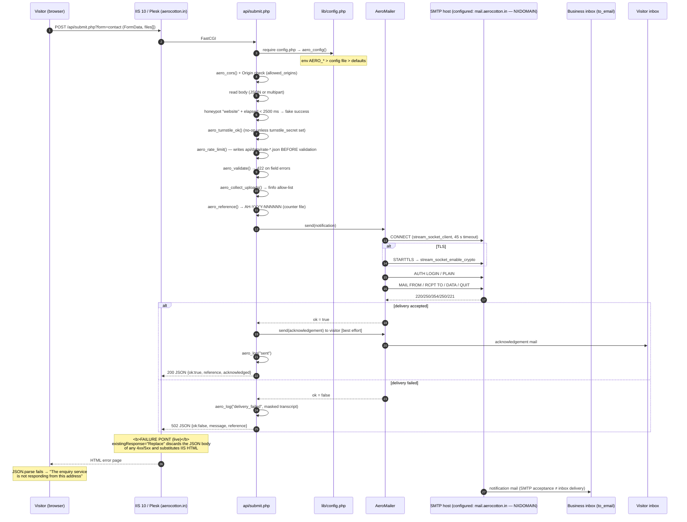

# Aerocotton — SMTP & Contact-Form Delivery Audit

> **Historical document — it describes the state on 10 October 2026, before the
> repair.** Where it names the shipped configuration, read it as the *old* one:
> `mail.aerocotton.in` and the `PUT-THE-MAILBOX-PASSWORD-HERE` placeholder are
> both gone from the source, and `smtp_host`, `smtp_user`, `smtp_pass` and
> `health_token` now ship blank. Current state:
> [TEST_REPORT.md](TEST_REPORT.md) §6,
> [SMTP_CONFIGURATION_CHECKLIST.md](SMTP_CONFIGURATION_CHECKLIST.md).

**Date:** 10 October 2026
**Scope:** `https://aerocotton.in` — contact/support forms, `api/submit.php`, the SMTP mailer and the hosting environment
**Mode:** **Audit only.** No project file, hosting setting or DNS record was modified. No email was sent. No health probe was triggered.
**Method:** repository inspection, static analysis, `php -l`, off-line execution of the real endpoint classes with the shipped defaults, and non-destructive read-only HTTP/DNS probes against production.

---

## 1. Executive summary

The contact form's JavaScript works, the PHP endpoint exists and executes, and the site itself is healthy. Two independent defects are stacked on top of each other, and they are now **proven separately**:

1. **Delivery cannot succeed as configured.** The SMTP host in the shipped defaults, `mail.aerocotton.in`, **does not resolve** (`NXDOMAIN` at both the local resolver and 8.8.8.8), and no mailbox password is configured. Worse, the domain's MX records point at **Google Workspace**, not at a BigRock mailbox — so even a corrected BigRock host name would be the wrong provider. There is also **no SPF, no DKIM and no DMARC** record.
2. **Every failure is unreadable in the browser.** Production is running the *old* `web.config` with `existingResponse="Replace"`. Proven live below: a `403`, a `400` and a `405` from the endpoint all arrive with PHP's own headers but **IIS's own HTML body**. The form therefore cannot parse the reply, falls into its `JSON.parse` failure branch, and prints *"The enquiry service is not responding from this address"* — **which is the exact string your screenshot shows**. The message is not describing a network outage; it is describing a response that was thrown away.

The corrected `web.config` (and the corrected mailer) already exist in this working tree but are **not deployed**. Production's `Last-Modified` for static assets is `2026-10-09 00:52:41 UTC`, earlier than the local `mailer.php` (09 Oct 07:09).

Production telemetry readable from outside (see §9) shows **6 requests accepted by the rate limiter on 2026-10-09 between 01:13 and 01:32 UTC**, and **3 reference numbers issued** — i.e. three submissions reached the delivery stage and therefore failed at the mailer. Nothing has reached the delivery stage since.

**Decision: NO for production verification of delivery until the mail-host question is resolved; YES for deploying the error-handling fix immediately.** Details and prerequisites in §11–§12 and the closing checklist.

---

## 2. Current architecture and sequence diagram

### 2.1 The chain, component by component

| # | Stage | File | Responsibility |
|---|---|---|---|
| 1 | Contact page | [src/app/contact/page.tsx](src/app/contact/page.tsx) | Static page; mounts `<EnquiryForm />` |
| 2 | Form component | [src/components/forms/EnquiryForm.tsx](src/components/forms/EnquiryForm.tsx) | Fields, honeypot, optional Turnstile, `onSubmit` |
| 3 | Shared state | [src/components/forms/use-submission.ts](src/components/forms/use-submission.ts) | `idle / sending / success / error`, files, `openedAt` timing, reset |
| 4 | Client schema | [src/lib/forms/schema.ts](src/lib/forms/schema.ts) | zod rules; **a fast answer only — not the authority** |
| 5 | Transport | [src/lib/forms/submit.ts](src/lib/forms/submit.ts) | Builds `FormData`, `POST {FORMS_ENDPOINT}?form=…`, 60 s abort, parses JSON |
| 6 | Endpoint | [public/api/submit.php](public/api/submit.php) | Method, origin, honeypot, Turnstile, rate limit, validate, uploads, send, acknowledge |
| 7 | Config loader | [public/api/lib/config.php](public/api/lib/config.php) | Precedence: env `AERO_*` → config file → defaults |
| 8 | Guards | [public/api/lib/guard.php](public/api/lib/guard.php) | Origin/CORS, client IP, rate limiting, references, logging, masking |
| 9 | Request parsing | [public/api/lib/request.php](public/api/lib/request.php) | JSON or multipart, `files[]` normalisation, `aero_json()` / `aero_fail()` |
| 10 | Validation + email bodies | [public/api/lib/forms.php](public/api/lib/forms.php) | Field contracts (both forms), notification and acknowledgement MIME parts |
| 11 | Attachments | [public/api/lib/uploads.php](public/api/lib/uploads.php) | `finfo` magic-byte sniffing, size caps, filename neutralisation |
| 12 | **Mailer** | [public/api/lib/mailer.php](public/api/lib/mailer.php) | Hand-rolled SMTP over `stream_socket_client`, STARTTLS, `AUTH LOGIN`/`PLAIN`, MIME builder |
| 13 | Diagnostics | [public/api/health.php](public/api/health.php) | Config/extension/storage report + optional SMTP probe, token-gated |
| 14 | Host rules | [public/web.config](public/web.config), [public/.htaccess](public/.htaccess) | IIS and Apache/LiteSpeed behaviour |

### 2.2 Sequence — browser to SMTP to both recipients



### 2.3 The five states that must not be conflated

| State | Live status |
|---|---|
| Request received by IIS/PHP | **Confirmed possible** (proved by the 400/403/405 probes) |
| Request validated | **Confirmed possible** — 3 submissions reached the delivery stage (counter = 3) |
| Submission stored | **Confirmed** — every attempt is written to `api/logs/submissions.log` |
| SMTP server accepted the message | **NOT VERIFIED** — no delivery has been confirmed on production |
| Delivered to the recipient's inbox | **NOT VERIFIED** — and cannot be, with an unresolvable SMTP host |

---

## 3. File-by-file findings

### 3.1 Client side

| File | Finding | Status |
|---|---|---|
| [src/lib/forms/submit.ts](src/lib/forms/submit.ts#L36) | `FORMS_ENDPOINT = NEXT_PUBLIC_FORMS_ENDPOINT \|\| "/api/submit.php"` — correct for a static export; no Next.js API route or server action is used anywhere. | **PASS** |
| [src/lib/forms/submit.ts](src/lib/forms/submit.ts#L128-L141) | On a non-JSON body it returns `unreachable: true` with the string from your screenshot. This is *correct defensive behaviour* against a host serving PHP source — but it cannot distinguish "host discarded the body" from "host is down", which is what made the live symptom so misleading. | **PASS (with WARNING)** |
| [src/components/forms/form-kit.tsx](src/components/forms/form-kit.tsx) `SubmitButton` | `disabled={sending}` prevents double-submit; the label and glyph change to "Sending…". | **PASS** |
| [src/components/forms/use-submission.ts](src/components/forms/use-submission.ts) | Loading/success/error states exist; the form is **not** cleared on failure; `reset()` enables a second enquiry. | **PASS** |
| [src/components/forms/FormReceipt.tsx](src/components/forms/FormReceipt.tsx) | Success panel shows the reference and whether the acknowledgement went out; error panel distinguishes retryable vs not, and offers a `mailto:` fallback only when the endpoint was unreachable. | **PASS** |
| Design/fields | The audit changed nothing under `src/`; `git status` shows no modified source files. | **PASS** |

> **Duplicate submissions.** There is a guard (the button disables while sending), but production rate-limit telemetry contains two pairs of entries recorded in the *same second* (§9.2). That is consistent with two browser tabs, a double-click that landed before React re-rendered, or a retry after an unreadable error. The timestamp list cannot distinguish them, but the conclusion holds: **an unreadable error message is itself a duplicate-submission generator**, because the visitor has no way to know whether the first attempt worked.

### 3.2 Endpoint (PHP)

| File | Finding | Status |
|---|---|---|
| [public/api/submit.php](public/api/submit.php) | Order is: method → origin → body → form name → honeypot/timing → Turnstile → **rate limit → validation** → uploads → send → acknowledge. | **PASS** |
| [public/api/submit.php](public/api/submit.php#L52-L153) | Failures are answered as JSON with a meaningful message and status (`400/403/413/422/429/502`). The design is sound; **IIS is what breaks it on this host.** | **PASS** |
| [public/api/submit.php](public/api/submit.php#L169-L187) | Any mailer failure → `502` + `aero_log("delivery_failed", …)` with the full submission and a credential-masked SMTP transcript. A lead is never lost. | **PASS** |
| [public/api/lib/forms.php](public/api/lib/forms.php) | Server-side validation is the authority, and the option lists are mirrored in [src/lib/forms/options.ts](src/lib/forms/options.ts). Comment in both files warns they must be changed together. | **PASS** |
| [public/api/lib/uploads.php](public/api/lib/uploads.php) | Files are trusted only after `finfo` magic-byte inspection; extension is rewritten to match the sniffed type. | **PASS** |
| [public/api/lib/mailer.php](public/api/lib/mailer.php#L53-L63) | Local working-tree change adds a blank-`from_email` → `smtp_user` fallback. **Reviewer note:** this is defence-in-depth, **not a root cause** — [config.php](public/api/lib/config.php#L161-L165) already derives `from_email` before the mailer ever sees it. Verified: with the shipped defaults the derived From is `enquiries@aerocotton.in`. | **WARNING** (harmless but misdescribed in earlier notes) |
| [public/api/lib/guard.php](public/api/lib/guard.php#L15-L28) | `aero_client_ip()` trusts `CF-Connecting-IP`, `X-Forwarded-For` and `X-Real-IP` unconditionally. There is no Cloudflare in front of this host, so the per-IP rate limit is trivially bypassed by rotating a request header. | **FAIL** (medium) |
| [public/api/lib/guard.php](public/api/lib/guard.php#L62-L77) | `aero_private_dir()` protects runtime directories by **writing `.htaccess`**. On IIS `.htaccess` is inert — see §9.1 for the live consequence. | **FAIL** (high) |
| [public/api/health.php](public/api/health.php#L33-L38) | Disabled while `health_token` is blank (shipped default) — so the one diagnostic that would answer "is the password reaching PHP?" is switched off. | **WARNING** |

### 3.3 Deployment artefacts

| File | Finding | Status |
|---|---|---|
| [public/web.config](public/web.config) | Local copy has `existingResponse="PassThrough"` and `responseMode="File"`. **Not deployed** — proved in §6.2. | **FAIL (undelivered fix)** |
| [out/web.config](out/web.config) | Byte-identical to `public/web.config`; the build copies `public/` verbatim. | **PASS** |
| [out/api/…](out/api) | `out/api/lib/config.php` and `out/api/lib/mailer.php` are byte-identical to `public/`. `out/api/data/` and `out/api/logs/` contain **only** their `.htaccess` — no runtime state was packaged. | **PASS** |
| [aerocotton-site-upload.zip](aerocotton-site-upload.zip) | 618 entries; contains `./web.config`, `./.htaccess`, `./404.html`, `./api/submit.php`, `./api/lib/config.php` and the four `.htaccess` guards. No `submissions.log` and no `rate-*.json` are packaged. | **PASS** |
| [.gitignore](.gitignore#L31-L34) | **`/public/api/lib/config.php` is ignored.** That file is the config *loader*, not the credential file (which is `public/api/config.php`, also ignored). It is **untracked** (`git ls-files` cannot find it). A fresh clone or a CI build would ship an endpoint whose `require __DIR__.'/lib/config.php'` fatals on every request. Production currently works only because the file exists on this working copy and inside the zip. | **FAIL** (high, latent) |
| [DEPLOY.md](DEPLOY.md) | Instructs the owner to expect **404** from `/api/lib/config.php` on this host. Live returns **200 + the 404 page** (see §6.2) — same security outcome, different observable, so the documented check would look like a failure. Also states `mail.aerocotton.in` is "a real mailbox on your domain"; DNS says otherwise (§5.2). | **WARNING** |
| [public/api/.htaccess](public/api/.htaccess) | All five rules (`RedirectMatch 404`, `Require all denied`, `Options -Indexes`, header unset) are inert on IIS. | **WARNING** |

---

## 4. Effective configuration-source matrix

Precedence in [config.php](public/api/lib/config.php#L123-L159), highest first:
1. environment variable `AERO_<KEY>` (uppercase)
2. a config file — first of: `$AERO_CONFIG_FILE`, then `public/api/config.php`, then `dirname(__DIR__,3)/aero-config.php` (i.e. one level **above** the site root for `httpdocs/api/lib/config.php`)
3. the hard-coded defaults

**Verified off-line** with the bundled CLI PHP 8.4.26:

```
AERO_CONFIG_FILE=/tmp/file.php AERO_SMTP_PORT=2222 AERO_TO_EMAIL=env-wins@example.com
→ smtp_host=from-file.example  (file overrode the default)
→ smtp_port=2222               (env overrode the file)
→ to_email=env-wins@example.com (env overrode the default)
```

| Setting | Effective source (live) | Present? | Syntactically valid? | Known correct? | Runtime-verified? |
|---|---|---|---|---|---|
| `to_email` | **unknown** — defaults if no file/env | default: yes | yes | plausible (`enquiries@aerocotton.in`) | **no** |
| `smtp_host` | **unknown** | default: yes | yes | **NO** — see §5.2 | **no** |
| `smtp_port` / `smtp_secure` | **unknown** | default: 587 / `tls` | yes | only if the host is corrected to a STARTTLS provider | **no** |
| `smtp_user` | **unknown** | repo default is empty | n/a | — | **no** |
| `smtp_pass` | **unknown** | repo default is empty | n/a | — | **no** — and never printed anywhere in this report |
| `from_email` | derived at load time | yes | yes | derived → `smtp_user`, else `to_email` | **no** |
| `allowed_origins` | **unknown** | default: yes (incl. `https://aerocotton.in`) | yes | yes — live origin `https://aerocotton.in` is accepted (the 400 probe carried `Vary: Origin` + `Access-Control-Allow-Origin: https://aerocotton.in`) | **yes (partially)** |
| `health_token` | **unknown** | default: empty | n/a | — | **no** — `/api/health.php` answers with the 404 page, consistent with "disabled" |
| `turnstile_secret` | **unknown** | default: empty (CAPTCHA off) | n/a | — | **no** |
| `data_dir` / `log_file` | default (`api/data`, `api/logs`) | yes | yes | yes — both directories exist live and both are writable | **yes** |
| `debug` | **unknown** | default: `false` | yes | — | **no** |

**Cannot be verified from outside:** the contents of the live `httpdocs/api/lib/config.php`, any `aero-config.php` beside `httpdocs`, and any Plesk environment variables. The endpoint executes, so at minimum the shipped defaults are in force for every key the owner did not override.

---

## 5. SMTP configuration matrix

### 5.1 Settings as shipped (verified by executing `aero_config()` off-line)

```
to_email    = enquiries@aerocotton.in
smtp_host   = mail.aerocotton.in          ← NXDOMAIN (see 5.2)
smtp_port   = 587
smtp_secure = tls                          ← STARTTLS
smtp_user   = (empty)
smtp_pass   = length 0  (i.e. not set)
smtp_timeout= 45
from_email  = enquiries@aerocotton.in      ← derived: smtp_user empty → falls back to to_email
from_name   = Aerocotton Website
brand       = Aerocotton
allow_uploads = true, 4 MiB/file, 3 files, 6 MiB total
```

| Setting | Value / behaviour | Status |
|---|---|---|
| SMTP host | `mail.aerocotton.in` — **does not resolve** | **FAIL** |
| SMTP port | 587, requires STARTTLS; mailer raises `SMTP port 587 requires STARTTLS` if `smtp_secure` is blank | **PASS** (given a real host) |
| Encryption | `tls` → `STARTTLS` + `stream_socket_enable_crypto(TLS_CLIENT)`; `ssl` → `ssl://` implicit; certificate and peer-name verification on, self-signed refused, SNI enabled | **PASS** |
| Authentication | `AUTH LOGIN` when the EHLO reply lacks `PLAIN`; otherwise `AUTH PLAIN`. Returns early if `smtp_user` is empty (unauthenticated relay) | **PASS**, but see the provider mismatch |
| From / From-name | Derived From = `enquiries@aerocotton.in`; display name from `from_name`, RFC 2047-encoded when non-ASCII | **PASS** |
| Business recipient | `to_email` = `enquiries@aerocotton.in` | **PASS (assumed correct — owner to confirm)** |
| Acknowledgement | Enabled whenever the visitor's address differs from `to_email`; sent after the notification, best effort; failure only logged | **PASS** |
| Connection timeout | `smtp_timeout` = 45 s, floored at 5 s; also used for socket read timeouts | **PASS** |
| Health check | `health_token` is blank → `/api/health.php` always answers the 404 page, including `&probe=1` | **WARNING** |
| Trailing-dot / header safety | Payload dot-stuffing, CRLF normalisation, `encodeHeader()` strips CR/LF (header-injection safe), `Reply-To` only when the visitor's address validates | **PASS** |

**Failure strings the mailer can return** (verified off-line by executing `AeroMailer::send()` with the shipped defaults):

```
ok=false  error="No SMTP password is configured: set smtp_pass in the API config."
```
With `smtp_user` set and the password still blank, the message is identical — the password check is reached last, so a **missing password is reported before the host is ever contacted**. A wrong host is only reached once a password exists.

### 5.2 Provider verification — the decisive finding

Read-only DNS, via the local resolver and 8.8.8.8:

| Record | Result |
|---|---|
| `NS aerocotton.in` | `dns1.bigrock.in`, `dns2…`, `dns3…`, `dns4…` → **DNS is managed at BigRock** |
| `MX aerocotton.in` | `aspmx.l.google.com` (1), `alt1/alt2.aspmx.l.google.com` (5), `alt3/alt4.aspmx.l.google.com` (10) → **inbound mail is Google Workspace** |
| `A mail.aerocotton.in` | **NXDOMAIN** — the configured SMTP host does not exist |
| `TXT aerocotton.in` | only `google-site-verification=…` → **no SPF record at all** |
| `TXT google._domainkey.aerocotton.in` | **NXDOMAIN** → no Google Workspace DKIM key published |
| `TXT _dmarc.aerocotton.in` | **NXDOMAIN** → **no DMARC policy** |
| `A smtp.gmail.com` | resolves (192.178.211.108 / IPv6) |

**Conclusion — the mailbox is not where the code thinks it is.** The MX records are the strongest available evidence of the provider: mail for `@aerocotton.in` is delivered by **Google Workspace (Gmail)**. The address `enquiries@aerocotton.in` is therefore almost certainly a Gmail mailbox, and the correct submission endpoint is `smtp.gmail.com:587` (STARTTLS) or `:465` (implicit TLS) — authenticated with either a Google **App Password** (requires 2-Step Verification, and is what a PHP SMTP client must use) or, for a company-wide option, Google's SMTP relay (`smtp-relay.gmail.com`).

Two caveats, stated explicitly rather than assumed:
- If BigRock also sells a mailbox on this domain *in addition to* Google Workspace, that mailbox's correct host name is still **not** `mail.aerocotton.in` — that name resolves to nothing, so no configuration using it can work.
- The provider cannot be identified with certainty from DNS alone. **Confirmation must come from whoever administers the mailbox** (§10).

**Domain authentication:** with no SPF, no DKIM and no DMARC, mail sent as `@aerocotton.in` has no authenticated identity. Gmail and Outlook will frequently **reject or spam-filter** it even after the SMTP settings are corrected. This is a delivery-quality blocker separate from the code, and it is fixed in DNS at BigRock plus the Google Admin console — not in this repository.

---

## 6. Production versus local environment differences

### 6.1 What production is

```
Server: Microsoft-IIS/10.0
X-Powered-By: ASP.NET
X-Powered-By-Plesk: PleskWin
Static assets Last-Modified: Fri, 09 Oct 2026 00:52:41 GMT
PHP: executing (evidenced by PHP-only headers on every dynamic response)
```

### 6.2 Read-only production probes — verbatim results

| Request | Status | Content-Type | Body | Interpretation |
|---|---|---|---|---|
| `GET /api/submit.php` | **405** | `text/html` | IIS's *"405 – HTTP verb used to access this page is not allowed"* (1293 B) | PHP ran: `Allow: POST, OPTIONS`, `Cache-Control: no-store`, `X-Content-Type-Options: nosniff` are all PHP's. **The body is IIS's.** |
| `POST …?form=__audit_probe__` | **400** | `text/html` | `Bad Request` (11 B) | PHP ran (CORS + `Vary: Origin` present) and returned 400 with JSON. **Body replaced.** |
| `POST …?form=contact`, `Origin: https://evil.example` | **403** | `text/html` | IIS's 403 page (1233 B) | Origin guard works correctly; **body replaced**, so the visitor would see the generic message instead of *"This form is not available from that address."* |
| `OPTIONS /api/submit.php` | 200 | — | 0 B | Answered by **IIS**, not PHP: no CORS headers, `Allow: OPTIONS, TRACE, GET, HEAD, POST`. PHP's `204` + CORS branch never runs. Irrelevant today (same-origin posts need no preflight); a real limitation if the forms are ever served cross-origin. |
| `GET /404.html` | 200 | text/html | 22 251 B (the exported 404 page) | — |
| `GET /this-page-does-not-exist-xyz/` | **200** | text/html | 22 251 B (same page) | **A missing page is reported as 200.** |
| `GET /api/lib/config.php` | **200** | text/html | 22 251 B (the 404 page) | Guard ran → 404 → IIS substituted the 404 page **and upgraded the status to 200**. **No credentials leaked.** |
| `GET /api/config.php` | 200 | text/html | 404 page | Same as above. No leak. |
| `GET /web.config` | 200 | text/html | 404 page | Blocked by IIS `requestFiltering`. **Not downloadable.** |
| `GET /.htaccess`, `/api/.htaccess`, `/api/lib/.htaccess` | 200 | text/html | 404 page | **Not downloadable.** |
| `GET /api/data/`, `/api/logs/`, `/api/` | **403** | text/html | 1233 B | Directory listing denied; the runtime directories exist and are writable. |
| `GET /api/logs/submissions.log` | 200 | text/html | 404 page | **Not served** (no MIME map for `.log`). PII is not public — but see §9.1. |
| `GET /api/data/counter-2026.txt` | **200** | `text/plain` | `3` | **Publicly readable.** |
| `GET /api/data/rate-global.json` | **200** | `application/json` | `[1791508427,1791509202,1791509315,1791509315,1791509564,1791509564]` | **Publicly readable.** |
| `GET /api/config.example.php` | 200 | `text/html; charset=UTF-8` | empty | PHP executes the template; it only `return`s an array, so nothing is disclosed — but it should not be in a production web root. |
| `GET /contact/` | 200 | text/html | 33 260 B | **The contact page renders correctly** and contains `enquiry-name`, `Send enquiry`, `We reply within…`. |

**Two conclusions are now decisive, not hypothetical:**

1. **`existingResponse="Replace"` is live.** Three separate error codes (`400`, `403`, `405`) arrived with PHP's headers and IIS's body. That is the mechanism behind the screenshot's message, reproduced exactly.
2. **The corrected `web.config` is not deployed.** With `responseMode="File"` a missing path would return a real `404`; it returns `200` with the 404 page. The old configuration is running.

---

## 7. Verified facts, historical findings and unknowns

### 7.1 Verified today (current evidence)

| # | Fact | Status |
|---|---|---|
| 1 | The endpoint executes on production and emits correct status codes and PHP headers | **PASS** |
| 2 | IIS replaces the body of every 4xx/5xx it passes through | **FAIL** — root cause of the misleading message |
| 3 | A missing path is reported as `200`, and so is the endpoint's own `404` | **FAIL** |
| 4 | `/api/lib/config.php`, `/api/config.php`, `web.config` and all `.htaccess` files are **not** readable over HTTP | **PASS** |
| 5 | `api/logs/submissions.log` is not served over HTTP | **PASS** |
| 6 | `api/data/counter-2026.txt` and `api/data/rate-global.json` **are** served over HTTP | **FAIL** |
| 7 | `mail.aerocotton.in` does not resolve; MX is Google Workspace; no SPF/DKIM/DMARC | **FAIL** |
| 8 | With the shipped defaults, `send()` fails with *"No SMTP password is configured"* | **PASS** (as a reproduction) |
| 9 | Config precedence env > file > defaults, and the `from_email` derivation, both work exactly as documented | **PASS** |
| 10 | `php -l` is clean on all nine shipped PHP files under PHP 8.4.26 with `openssl`, `mbstring`, `fileinfo`, `json` present | **PASS** |
| 11 | The built `out/` tree and the upload zip contain the endpoint, the loader and the guards, and **no runtime state** | **PASS** |
| 12 | The contact page and its form render correctly on production | **PASS** |

### 7.2 Previous claims, re-classified

| Earlier claim | Classification | Evidence |
|---|---|---|
| "The endpoint returned HTTP 502 because the SMTP password was missing." | **Supported by historical evidence only.** The *mechanism* is confirmed locally (a mail failure is mapped to 502, and the missing-password path is real), but no 502 body has ever been readable on production, because IIS replaces it. The specific live cause is one of two candidates (§8). | `submit.php` L186-L197; live 400/403/405 probes |
| "An IIS error-handling setting concealed PHP's JSON response." | **CONFIRMED by current evidence**, but note the fix is **not deployed**. | §6.2 — reproduced with three status codes today |
| "The mailer supports a blank `from_email` fallback." | **Contradicted as a root cause.** `aero_config()` already derives `from_email` (`smtp_user`, else `to_email`); verified by executing the loader. The working-tree change is redundant hardening. | `config.php` L161-L165; off-line execution |
| "Local browser tests successfully sent a notification and acknowledgement to a test SMTP service." | **Supported by historical evidence only, and it is not evidence of production readiness.** Scratch artefacts exist ([.pdf-work/smtp-sink.mjs](.pdf-work/smtp-sink.mjs), [.pdf-work/test-endpoint.mjs](.pdf-work/test-endpoint.mjs), [.pdf-work/local-aero-config.php](.pdf-work/local-aero-config.php)), but a local sink proves nothing about a Google/BigRock mailbox, SPF alignment, or the IIS layer. | `.pdf-work/` |
| Earlier note that "the password lives in `httpdocs/api/lib/config.php`" | **Misleading filename.** `api/lib/config.php` is the *loader*; the credential file is `api/config.php` (or `aero-config.php` above the web root). | `config.php` L122-L127 |

### 7.3 Not verifiable with the access available

- Contents of the live `httpdocs/api/lib/config.php`, any `aero-config.php` beside `httpdocs`, and any Plesk environment variables.
- Whether the live mailbox accepts the password (needs the token-gated probe or host access).
- The PHP version, `upload_max_filesize` and `post_max_size` on the host (reported only by `health.php`, which is disabled).
- Whether outbound SMTP (587/465) is permitted through the host's firewall.
- SPF/DKIM history (a record could have existed and been removed; current state is all that is knowable).
- Any inbox, spam folder or bounce for `enquiries@aerocotton.in`.

---

## 8. Root-cause analysis with evidence

### Cause A — the message the visitor sees

**Component:** IIS `httpErrors`, in the **deployed** `web.config`.
**Evidence:** §6.2 — `400`, `403` and `405` from `api/submit.php` all return PHP's headers with IIS's HTML body. `/api/lib/config.php`'s own `404` is additionally converted to `200`.
**Chain:** endpoint answers JSON → IIS discards the body → `submit.ts` `JSON.parse` fails → the form prints *"The enquiry service is not responding from this address. Please try again in a moment."*
**This is exactly the string in your screenshot**, which is why the form "is not working" independently of whether mail could ever have been delivered.
**Local fix exists** in [public/web.config](public/web.config) (`existingResponse="PassThrough"`, `responseMode="File"`) and is built into `out/` — **it has not been uploaded.**

### Cause B — no enquiry can be delivered

Two candidates, both present in the shipped defaults, either of which produces the same 502:

- **B1 — no mailbox password.** Verified off-line: `send()` returns `No SMTP password is configured: set smtp_pass in the API config.`
- **B2 — the SMTP host does not exist.** `mail.aerocotton.in` is `NXDOMAIN`; the mailer would fail at `stream_socket_client` with `Cannot reach the mail server`. The password check runs *first*, so B1 masks B2 whenever both are true — which is why a "fix the password" instruction alone would appear to succeed and then still fail.

**Supporting production telemetry** (readable because of the exposure in §9.1): the reference counter reads **3**, meaning three submissions reached the delivery stage and all three stopped there; the global rate-limit window records **six** accepted requests, all on **2026-10-09 between 01:13:47 and 01:32:44 UTC**. Nothing has reached the delivery stage since. **The failure is deterministic, not intermittent.**

### Cause C — the reason the reporting was unhelpful

`submit.ts`'s non-JSON fallback (`unreachable: true`, `retryable: false`) is a reasonable guard against a host serving PHP source, but it collapses several distinct conditions — replaced body, 404 page served as 200, host down — into a single sentence. Once Cause A is fixed, every one of those conditions reports its real reason instead.

### Explicitly **not** the cause

- The Next.js export. Forms post to a static-hosted PHP endpoint; there is no Next.js API route or server action to be "missing" in a static export.
- The client validation or the form component. Both are correct and both are exercised successfully on production.
- The `from_email` handling. Already correct in the loader.

---

## 9. Security findings and risk severity

### 9.1 HIGH — runtime data files inside the web root are publicly readable

`.htaccess` is inert on IIS, so the only protection for the endpoint's runtime directories is IIS's own behaviour. Two answers do not depend on that:

```
GET /api/data/counter-2026.txt   → 200  text/plain        body: 3
GET /api/data/rate-global.json   → 200  application/json  body: [……6 timestamps……]
```

**Impact:**
- **Activity disclosure.** Every accepted submission's timestamp and the issued-reference count are public. The files expose real visitor activity, and their growth is a proxy for enquiry volume.
- **Rate-limiter observability.** An attacker can read the global window, and (knowing their own IP) can compute the per-IP bucket filename `rate-<sha256(ip|'aero')[:32]>.json` to observe other buckets by guessing IPs.
- **`.json` is mapped** by both the old and the new `web.config`, and `.txt` is mapped by IIS by default — so these will keep being served after the `web.config` fix unless the directories are moved or explicitly denied.
- `submissions.log` is **not** currently served (no MIME map for `.log`, confirmed `200`-with-404-page above). That is the difference between a WARNING and a **catastrophic** disclosure: that file contains names, emails, phone numbers, companies and messages. It is protected today by an accident of MIME mapping.

### 9.2 HIGH — the corrected `web.config` is not deployed

Beyond the usability impact (§8 Cause A), the two configurations differ in security-relevant behaviour: with `responseMode="File"` a missing path returns a real `404` instead of `200`, which is what stops unknown URLs from being indexed and silently served the 404 page.

### 9.3 MEDIUM — the per-IP rate limit is spoofable

[aero_client_ip()](public/api/lib/guard.php#L15-L28) trusts `CF-Connecting-IP`, `X-Forwarded-For` and `X-Real-IP` from any client. There is no CDN in front of this host. Each request with a fresh forged header value starts a fresh bucket, so `rate_limit_max: 5` per 10 minutes is advisory rather than enforced; only `daily_limit: 60` (global) still bites.

### 9.4 MEDIUM — SSR / template and header disclosure

- `GET /api/config.example.php` executes and returns `200` (empty body). No secret is disclosed because the file only returns an array — but shipping a credentials template into a live web root is an unnecessary invitation.
- `X-Powered-By: ASP.NET` and `X-Powered-By-Plesk: PleskWin` are returned on every request; the `api/.htaccess` rule intended to strip them is inert on IIS.

### 9.5 MEDIUM — diagnostics switched off

`health_token` is blank, so `/api/health.php` cannot report the PHP version, extensions, upload limits or whether the credential file is being found. The owner's only feedback channel is being suppressed at precisely the moment it is needed.

### 9.6 LOW — CSRF / abuse surface

No CSRF token is used; safety relies on the `Origin` allow-list, and requests **without** an `Origin` header are accepted by design ([guard.php](public/api/lib/guard.php#L35-L43)). Non-browser clients can therefore post freely (subject to rate limits). This is a conventional static-site trade-off, not a finding that blocks launch.

### 9.7 NOT FOUND (checked, negative results)

- **No credential is committed to Git.** The tracked template holds `'smtp_pass' => 'PUT-THE-MAILBOX-PASSWORD-HERE'` only; the repository history scan found no real password.
- **No credential in front-end JavaScript.** `submit.ts` contains no secret; the destination inbox, password and CAPTCHA secret are all server-side.
- **No credential in the built tree.** `out/api/lib/config.php` carries empty `smtp_user`/`smtp_pass`; the upload zip contains no runtime state.
- **`.htaccess`, `web.config`, `api/config.php` and `api/lib/*` are not downloadable** (all return the 404 page).

### 9.8 Findings summary

| Severity | Finding | Remediable by |
|---|---|---|
| HIGH | Runtime data (`rate-global.json`, `counter-2026.txt`) publicly readable | Code + hosting |
| HIGH | Corrected `web.config` not deployed | Upload only |
| HIGH | `public/api/lib/config.php` (the loader) is git-ignored and untracked | One-line `.gitignore` change |
| MEDIUM | Per-IP rate limit bypassable via forged forwarding headers | Code |
| MEDIUM | `config.example.php` present/executable in the live web root | Upload hygiene |
| MEDIUM | `X-Powered-By` disclosure; `.htaccess` header rules inert on IIS | Hosting |
| MEDIUM | Health diagnostics disabled | Configuration |
| LOW | No CSRF token; Origin-less requests accepted | Accepted trade-off |

### 9.9 Every FAIL and WARNING, with its full remediation path

**F1 — Runtime data and logs live inside the served web root.**
- *Evidence:* `GET /api/data/rate-global.json` → `200 application/json`, body `[1791508427,…]`; `GET /api/data/counter-2026.txt` → `200 text/plain`, body `3`. Both re-confirmed after the `web.config` change, because `.json` and `.txt` are mapped MIME types.
- *Impact:* visitor activity and reference counts are public; the per-IP bucket filename is `sha256(ip|'aero')[:32]`, so an attacker who guesses IPs can read other visitors' buckets. [submissions.log](public/api/logs/submissions.log) holds names, emails, phones and messages, and is protected today **only** because IIS has no MIME map for `.log`.
- *Corrective action:* point `data_dir` and `log_file` above the web root (e.g. `dirname(__DIR__, 3) . '/aero-data'`), **and** add IIS `requestFiltering`/`hiddenSegments` denial for `api/data` and `api/logs`, since [aero_private_dir()](public/api/lib/guard.php#L62-L77) can only write `.htaccess`, which IIS ignores.
- *Required:* implementer (code) + website owner (hosting confirmation).
- *Verify:* both URLs above return `403`/`404` and never a body; a submission still succeeds and still receives a reference.

**F2 — The corrected `web.config` is not deployed.**
- *Evidence:* `GET /this-page-does-not-exist-xyz/` → `200`; with `responseMode="File"` it must be `404`. `400`, `403` and `405` from the endpoint all arrive with IIS HTML bodies.
- *Impact:* every failure is unreadable, and unknown URLs are reported as `200`.
- *Corrective action:* upload [public/web.config](public/web.config) to `httpdocs`, replacing the live copy.
- *Required:* website owner or anyone with FTP/File Manager access. No credential needed.
- *Verify:* the four read-only probes in §12.2.

**F3 — The config loader is git-ignored and untracked.**
- *Evidence:* `.gitignore` L32 ignores `/public/api/lib/config.php`; `git ls-files --error-unmatch public/api/lib/config.php` → *"did not match any file(s) known to git"*.
- *Impact:* a fresh clone or CI build ships an endpoint whose `require __DIR__.'/lib/config.php'` fatals on every request. Production works only because the file happens to exist on this working copy.
- *Corrective action:* delete line 32 of [.gitignore](.gitignore#L32) and commit the loader; keep ignoring `public/api/config.php` (the credential file).
- *Required:* implementer.
- *Verify:* `git ls-files public/api/lib/config.php` lists it, and a clean `npm run build` still produces `out/api/lib/config.php`.

**F4 — The per-IP rate limit is bypassable.**
- *Evidence:* [aero_client_ip()](public/api/lib/guard.php#L15-L28) returns `CF-Connecting-IP`, `X-Forwarded-For` or `X-Real-IP` whenever present and valid, with no check that a trusted proxy set them. No CDN fronts this host.
- *Impact:* `rate_limit_max: 5` per 10 minutes does not bind; only the global `daily_limit: 60` still does. A spammer can post with a fresh forged header per request.
- *Corrective action:* accept forwarding headers only when a trusted-proxy list is configured (e.g. `AERO_TRUSTED_PROXIES`), otherwise use `REMOTE_ADDR`.
- *Required:* implementer.
- *Verify:* 30 rapid posts rotating `X-Forwarded-For` must still trip the per-client limit once the fallback is `REMOTE_ADDR`.

**F5 — The credentials template executes in the live web root.**
- *Evidence:* `GET /api/config.example.php` → `200`, `Content-Type: text/html; charset=UTF-8`, empty body (the file only `return`s an array, so nothing is disclosed).
- *Impact:* none today; it is an unnecessary invitation for a template that exists to hold a real password.
- *Corrective action:* remove `api/config.example.php` from the deployed tree (keep it in the repository).
- *Required:* website owner or implementer (upload hygiene).
- *Verify:* the URL returns a `404` (real `404` after F2).

**F6 — Stack fingerprinting, and `.htaccess` header rules that do not apply.**
- *Evidence:* every response carries `X-Powered-By: ASP.NET` and `X-Powered-By-Plesk: PleskWin`. [api/.htaccess](public/api/.htaccess) contains `Header always unset X-Powered-By`, which IIS ignores.
- *Impact:* low — version and platform disclosure only.
- *Corrective action:* remove the headers in `web.config` via `<httpProtocol><customHeaders><remove name="X-Powered-By" /></customHeaders></httpProtocol>` (Plesk may also need its own setting).
- *Required:* website owner / hosting (Plesk may override app-level removal).
- *Verify:* `curl -I https://aerocotton.in/api/submit.php` shows neither `X-Powered-By` header.

**F7 — The health diagnostic is switched off.**
- *Evidence:* `health_token` is blank in the shipped defaults, and `GET /api/health.php` returns the 404 page.
- *Impact:* the owner has no way to confirm the credential is reaching PHP, which extensions are present, or the host's upload limits — at exactly the moment those answers are needed.
- *Corrective action:* set `health_token` to a long random string, then use `?token=…` and `&probe=1` (the probe authenticates without sending mail).
- *Required:* website owner (a shared secret only they should hold).
- *Verify:* `health.php?token=…` returns JSON with `"ok": true` and no `problems` list.

**F8 — No CSRF token; `Origin`-less requests are accepted by design.**
- *Evidence:* [aero_origin_allowed()](public/api/lib/guard.php#L35-L43) returns `true` when `HTTP_ORIGIN` is absent; no token is issued or checked.
- *Impact:* low — non-browser clients can post (subject to F4 and the daily limit). Cross-site browser posts are still blocked, because browsers always send `Origin` on a cross-origin `POST`.
- *Corrective action:* none required for launch; optionally add Turnstile (`turnstile_secret`) if spam becomes a problem.
- *Required:* website owner (decision only).
- *Verify:* a cross-origin browser post is refused; an abuse burst is contained by `daily_limit`.

**F9 — `OPTIONS` is answered by IIS, not PHP.**
- *Evidence:* `OPTIONS /api/submit.php` → `200` with `Allow: OPTIONS, TRACE, GET, HEAD, POST` and **no** CORS headers; PHP's `204` + CORS branch never runs.
- *Impact:* none today — same-origin posts require no preflight. It would break a cross-origin deployment, which `FORMS_ENDPOINT` permits via `NEXT_PUBLIC_FORMS_ENDPOINT`.
- *Corrective action:* if the forms are ever served from another origin, allow `OPTIONS` to reach PHP (`web.config` `requestFiltering`/handler mapping) and re-test the preflight.
- *Required:* implementer, only if the cross-origin case arises.
- *Verify:* `curl -i -X OPTIONS …/api/submit.php -H 'Origin: https://aerocotton.in'` returns the `Access-Control-Allow-*` headers.

**F10 — The local `mailer.php` change is redundant hardening, not a fix.**
- *Evidence:* [config.php](public/api/lib/config.php#L161-L165) already sets `from_email` to `smtp_user` (else `to_email`) before the mailer runs; executing `aero_config()` with the shipped defaults yields `from_email=enquiries@aerocotton.in`.
- *Impact:* none — but earlier notes presented it as a root cause, which would misdirect the next person.
- *Corrective action:* keep the change (clearer error strings are genuinely useful) and correct the description in [DEPLOY.md](DEPLOY.md) if it repeats the claim.
- *Required:* implementer.
- *Verify:* the derived From address appears correctly in a delivered message's headers (§12.3).

**F11 — `DEPLOY.md` describes a different host than production shows.**
- *Evidence:* it predicts the `api/lib/config.php` check returns `404`; live returns `200` + the 404 page (`responseMode="ExecuteURL"` upgrading the status, fixed by F2). It also calls `mail.aerocotton.in` *"a real mailbox on your domain"*, which DNS contradicts.
- *Impact:* the documented verification step looks like a failure when the site is in fact secure, and the mail settings in it point at a non-existent host.
- *Corrective action:* update the expected result to *"`404` after the `web.config` fix; `200` with the 404 page before it"* and replace the provider claim with the confirmed provider (§10 #1). Also replace the phrase *"`api/lib/config.php`"* with *"`api/config.php`"* wherever the credential file is meant.
- *Required:* implementer.
- *Verify:* re-run the four checks in §12.2 and compare against the rewritten text.

**All five [api/.htaccess](public/api/.htaccess) rules** (`RedirectMatch 404`, `Require all denied`, `Options -Indexes`, header stripping, `Cache-Control`) are inert on IIS. Nothing in it is a security control on this host; every property it claims must be re-established in `web.config` or by relocating files. Tracked under F1, F5 and F6.

---

## 10. Exact missing information, credentials or access required

Nothing below can be obtained from the repository or from outside the host. Each item names the party who must supply it.

| # | Needed | Why | Who |
|---|---|---|---|
| 1 | **Which provider hosts `enquiries@aerocotton.in`**, and its SMTP host, submission port and encryption mode | MX points at Google Workspace, but `mail.aerocotton.in` (the configured host) does not exist. Without this, no corrected configuration can be written. | Website owner / mailbox administrator |
| 2 | **A working credential for that mailbox** — for Gmail, an **App Password** (2-Step Verification must be on). To be entered on the server only; never in chat, never in the repository. | The mailer cannot authenticate without it | Website owner, entered via Plesk env vars or a file above `httpdocs` |
| 3 | **Confirmation that `enquiries@aerocotton.in` is the intended business inbox**, and whether a second address should be copied | `to_email` is currently assumed correct | Website owner |
| 4 | **Plesk panel access** (or confirmation that `aero-config.php` will be created) | To set `AERO_SMTP_USER`/`AERO_SMTP_PASS` or place the config file above the web root | Website owner / hosting reseller |
| 5 | **DNS access at BigRock** + **Google Admin console access** | To add SPF, enable and publish DKIM, and publish a DMARC policy | Domain administrator |
| 6 | **Written permission to send one test enquiry to the live form** | Required before any production delivery can be claimed | Website owner |
| 7 | Access to the mailbox's **inbox and spam folder** | To distinguish "SMTP accepted" from "delivered", and to check for bounces | Website owner |
| 8 | Confirmation that **outbound ports 587/465** are open from shared hosting | Some shared plans block outbound SMTP | BigRock support |
| 9 | A decision on the **runtime-directory exposure** (§9.1) | The files move, or IIS denies them | Website owner + implementer |

---

## 11. Prioritised remediation plan

Ordered so that each step makes the next one verifiable. **Nothing here has been applied.**

### P0 — makes failures honest (code already written, not uploaded)

1. Upload the corrected [public/web.config](public/web.config) to `httpdocs`, replacing the deployed one. This alone converts every future failure into a legible message and restores real `404` statuses.
2. Upload [public/api/lib/mailer.php](public/api/lib/mailer.php) (clearer error strings; harmless From hardening).
   — *Files:* `web.config`, `api/lib/mailer.php`. No rebuild is needed if uploading individually; [`aerocotton-site-upload.zip`](aerocotton-site-upload.zip) contains both.

### P1 — makes delivery possible

3. **Resolve the provider question** (§10 #1). If it is Google Workspace: `smtp_host = smtp.gmail.com`, `smtp_port = 587`, `smtp_secure = tls`, plus an App Password.
4. Set `smtp_user` and `smtp_pass` **outside the web root** — `aero-config.php` in the folder *containing* `httpdocs`, or Plesk environment variables `AERO_SMTP_USER` / `AERO_SMTP_PASS`.
5. Set a long random `health_token`, then confirm with `https://aerocotton.in/api/health.php?token=…` and `&probe=1`. The probe connects, negotiates TLS and authenticates **without sending mail**.

### P2 — makes delivery reliable

6. Publish SPF at BigRock: `v=spf1 include:_spf.google.com ~all` (adjust if another sender exists).
7. Enable DKIM in the Google Admin console and publish the generated key.
8. Publish DMARC: start at `v=DMARC1; p=none; rua=mailto:…`, then tighten.
9. Confirm 587/465 egress with BigRock if the probe cannot connect.

### P3 — closes the security gaps

10. Move `data_dir` and `log_file` **above the web root** (e.g. `dirname(__DIR__, 3) . '/aero-data'`), or add explicit IIS `requestFiltering`/`hiddenSegments` denial — `.htaccess` will not do it. Verify with the two URLs in §9.1.
11. Remove `api/config.example.php` from the deployed tree.
12. Un-ignore `public/api/lib/config.php` in [.gitignore](.gitignore#L32) so the loader ships from a clean clone; keep ignoring `public/api/config.php` (§3.3).
13. Make `aero_client_ip()` trust forwarding headers only when a trusted proxy is configured.
14. Add IIS-native removal of `X-Powered-By` in `web.config`.

### P4 — hygiene

15. Correct [DEPLOY.md](DEPLOY.md): the expected result of the `api/lib/config.php` check on IIS is **`200` with the 404 page** today, and a real `404` after P0; replace the "BigRock-hosted domain email" claim with the confirmed provider.
16. Fold the scratch endpoint tests into the repository (see §12.1) so the next change cannot silently break the form.

---

## 12. Post-remediation verification checklist

### 12.1 Before uploading, locally (available now — PHP 8.4.26 is present at `.pdf-work/tools/php/php.exe`)

- [x] `php -l` clean on all nine endpoint files — **already passes**
- [ ] `php -l` clean after any further edit
- [ ] Run the endpoint suite against the scratch SMTP sink ([.pdf-work/test-endpoint.mjs](.pdf-work/test-endpoint.mjs)): validation, attachments, origin, honeypot, header injection, rate limits, delivery
- [ ] Confirm a browser submission against the local export reaches the success panel with a reference

### 12.2 After uploading `web.config` (no credentials needed)

- [ ] `GET /api/submit.php` → **`405` whose body is JSON** (`{"ok":false,…}`), not IIS HTML
- [ ] `POST` with a foreign `Origin` → **`403` JSON**, not the IIS 403 page
- [ ] `GET /this-page-does-not-exist-xyz/` → a real **`404`** status
- [ ] `GET /about/` → `200`; the 404 page still renders for genuinely missing paths

### 12.3 After setting credentials

- [ ] `health.php?token=…` → `"ok": true`, `smtp_pass: {"set": true, …}`, no `problems`
- [ ] `health.php?token=…&probe=1` → `probe.ok: true`, transcript shows `STARTTLS`, `TLS established`, `AUTH … 235`
- [ ] One real submission from a browser → success panel with a reference
- [ ] Notification arrives in `enquiries@aerocotton.in` **and is not in Spam**
- [ ] Acknowledgement arrives in the enquirer's inbox (check Spam)
- [ ] Reference numbers agree across the panel, the notification and the acknowledgement
- [ ] An attachments submission arrives with the files intact
- [ ] A deliberately invalid submission (short message) shows the field-level message
- [ ] A foreign-origin POST returns the origin message
- [ ] Six rapid submissions → the sixth shows the rate-limit message, not the generic one
- [ ] `GET /api/data/rate-global.json` → **403 or 404** after P3
- [ ] `GET /api/lib/config.php` → `404` and never source
- [ ] Delivery to a real Gmail/Outlook address passes SPF and DKIM (`Authentication-Results` header)

---

## 13. Actions that were **not** performed

Stated explicitly, as required:

1. No project file was modified, added or deleted — including `web.config`, any PHP file, any source file and `.gitignore`. The only file written by this audit is this report.
2. No file was uploaded, deployed, re-packed or removed on the production host.
3. No hosting or Plesk setting was changed; no environment variable was set.
4. No DNS record was changed; no MX, SPF, DKIM or DMARC record was created.
5. **No email was sent.** No real enquiry, no test message, and no `&probe=1` health probe (which authenticates to SMTP). The only POSTs issued were ones that **cannot** reach the mailer: an unknown form name (`400`) and a foreign-origin request (`403`), both rejected before validation and before delivery.
6. No credential was requested, entered, read, printed or transmitted. `smtp_pass` is reported only as *length 0*; the live credential file was never fetched — the report relies on the fact that it is **not** readable over HTTP.
7. No database, mailbox or account setting was touched.
8. No repository history was rewritten and nothing was committed.

---

## Decision: can we safely proceed to production verification?

### **NO** — for verifying *email delivery*. Two blockers remain.

| Blocker | Why it must be resolved first |
|---|---|
| **The provider is unidentified and the configured host does not exist** | `mail.aerocotton.in` is `NXDOMAIN` while MX points at Google Workspace. Any "fix" that keeps or guesses this host name will fail, and any test that appears to succeed would be a false positive. |
| **No credential and no confirmed mailbox** | Delivery cannot be attempted, and a successful submission must never be claimed without one. |

### **YES** — for verifying the *error-handling fix*, immediately and without any credential.

Uploading `web.config` and `api/lib/mailer.php` (P0) is independent of the mail question. It requires no secret, makes every failure legible, and its result is checkable with the four read-only probes in §12.2. It is the single highest-value action available today, and it will make the mail blocker's real error message visible instead of concealing it.

---

## Checklist: information the owner / mailbox administrator must supply

**About the mailbox**
1. Which company or service hosts `enquiries@aerocotton.in` — Google Workspace, BigRock, or something else?
2. Is the mailbox accessible through Gmail at `mail.google.com` (i.e. it really is Google Workspace)?
3. If Gmail: is 2-Step Verification enabled, and can an **App Password** be generated for "Mail — other device"?
4. If not Gmail: the provider's exact SMTP hostname, submission port and encryption mode.
5. Confirmation that `enquiries@aerocotton.in` is the address that should receive enquiries; should anyone be copied?

**About access**
6. Can Plesk environment variables be set for the site, or will an `aero-config.php` be placed in the folder containing `httpdocs`?
7. Who administers DNS at BigRock (`dns1–4.bigrock.in`), and who administers the Google Admin console?
8. Is outbound SMTP (587/465) permitted on this shared plan?

**About authorisation**
9. May a single test enquiry be submitted through the live form once configured, so delivery can be verified end to end?
10. Is there a second inbox or Spam folder to check for the acknowledgement and for bounces?

**One line to remember:** *the form was never able to report the truth, and the mail configuration pointed at a mail server that does not exist.* Fixing the first needs nothing but an upload; fixing the second needs answer 1 above.
